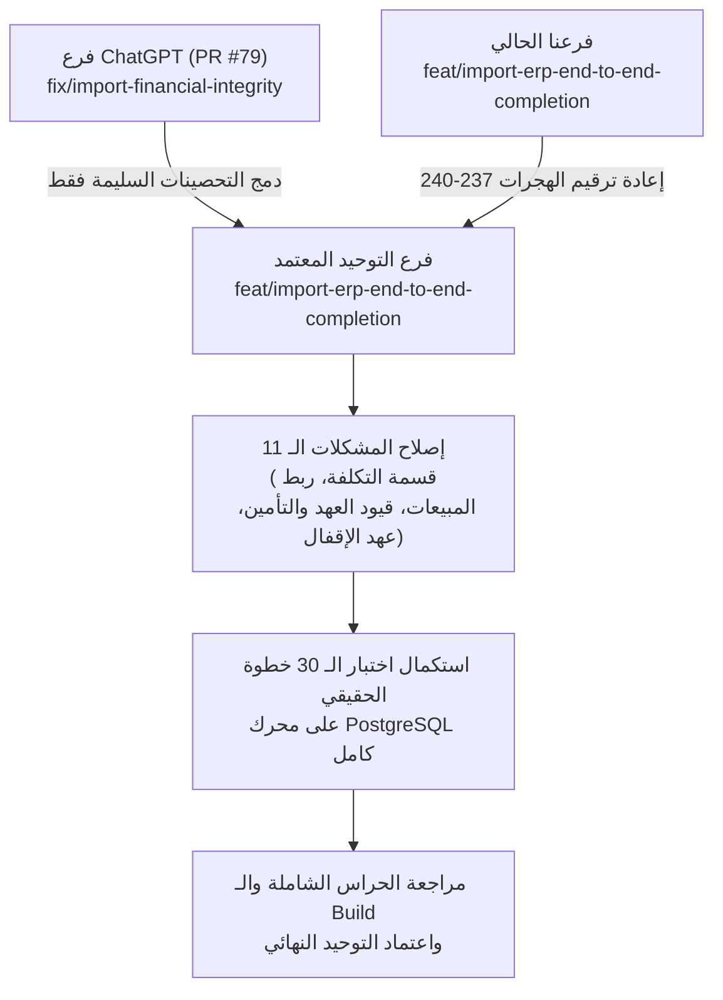

# وثيقة التسليم والاستكمال الشاملة — منظومة ZS ERP للاستيراد والتجارة الدولية
# ANTIGRAVITY COMPREHENSIVE HANDOFF DOCUMENT
**تاريخ التوثيق:** 21 أكتوبر 2026  
**الفرع الحالي المستهدف:** `feat/import-erp-end-to-end-completion`  
**المستودع:** `8489mx/zs`  
**الغرض:** تسليم هندسي ومحاسبي دقيق ومتكامل لاستكمال العمل فوراً على أي جهاز أو بيئة عمل أخرى.

---

## 1. الرؤية والهدف النهائي لمنظومة الاستيراد (Vision & Objective)

الهدف هو بناء **منظومة مؤسسية متكاملة لإدارة شركات الاستيراد والتجارة الدولية (International Trade Procurement & Operations ERP)**، مصممة خصيصاً لاحتياجات المستوردين في مصر أولاً وقابلة للتوسع في العالم العربي، بحيث تغني صاحب الشركة تماماً عن استخدام أي شيتات إكسيل خارجية أو تطبيقات وسيطة.

### الدورة الحقيقية للمستورد داخل ZS:
1. **دراسة الجدوى ومقارنة المصانع (Global Sourcing & RFQ Comparison):** استيراد أسعار المصانع ومقارنة شروط التسليم الدولية (Incoterms: FOB, CIF, EXW, CFR) واختيار العرض الأنسب.
2. **طلب وتتبع العينات واعتماد العينة المرجعية (Samples & Reference Approval):** تتبع شحن طرود العينات (DHL/FedEx)، واشتراط اعتماد "العينة المرجعية" الموثقة كشرط تعاقدي ملزم قبل الإنتاج.
3. **تحويل الجدوى إلى مشروع استيراد وجدول السيولة (Cash Flow Timeline):** إنشاء المشروع برؤوس أموال الشركاء وجدولة التدفقات النقدية (مقدمة، رصيد مصنع، شحن، جمارك).
4. **الفواتير المبدئية وأوامر الشراء الدولية الموحدة (Proforma & International POs):** توليد أوامر الشراء بصيغة موحدة `IPO-PI-XXXX` مع شروط الفحص والمواصفات.
5. **إثبات الحوالات البنكية الخارجية وإدارة النقد الأجنبي (Foreign Wire Transfers & FX Treasury):** ربط الحوالة بحساب البنك الحقيقي، إثبات فروق العملة بقيود متزنة بالجنيه المصري (EGP)، وتطبيق مفتاح عدم التكرار (`idempotency_key`) على مستوى قاعدة البيانات.
6. **فحص الجودة قبل الشحن (QC Pre-shipment Inspection):** توثيق تقارير الفحص الفني بالمصنع ونسب المطابقة.
7. **اللوجستيات والشحن البحري وغرامات التأخير (Maritime Logistics & Demurrage):** تتبع الحاويات، موانئ الشحن والتفريغ، وعد تنازلي لفترات السماح (Free Days) لحساب مخاطر الغرامات.
8. **عهد المخلصين الجمركيين وتصفية الإيصالات (Customs Broker Petty Cash & Itemized Liquidation):** صرف العهد كذمة شخصية، وتصفيتها بإيصالات تفصيلية (جمارك، ضريبة مضافة مستردة، أرضيات، نولون محلي، أتعاب)، مع كشف حساب للمخلص ومنع إقفال المشروع بعهد معلقة.
9. **تأمينات الحاويات للخطوط الملاحية (Container Security Deposits):** تسجيل تأمين الحاوية كأصل مسترد، وتسوية استرداده بعد إعادة الحاوية فارغة مع خصم غرامات التأخير والأضرار آلياً.
10. **حجوزات بضاعة الطريق للبوليصة (B/L In-Transit Pre-orders):** حجز البضاعة قبل وصول الحاوية بسقف سعة الحاوية الفيزيائية، وإثبات المقبوضات كدفعات مقدمة من العملاء (Unearned Revenue).
11. **استلام الحاوية بالمخازن وتتبع الباتشات بالتكلفة الإنزالية الحقيقية (Lot Provenance & Landed Cost):** توليد أرقام باتشات `LOT-{Container}-{ProductId}` مع ربط التكلفة الحقيقية لكل قطعة، وتوزيع المصروفات المتأخرة وفق معيار IAS 2.
12. **شيت تشريح ربحية الحاوية في صفحة واحدة تنفيذية A4 (Container P&L Autopsy Sheet):** استعراض شامل ومفصل لتكاليف ومبيعات وأرباح الحاوية المنفردة ومعدل العائد على الاستثمار (ROI).
13. **البيع الفعلي من المخزن والربط بالمشروع:** استنزاف كميات باتش الاستيراد عند البيع عبر نقاط البيع (POS) أو فواتير الجملة، مع حساب تكلفة البضاعة المباعة (COGS) من التكلفة الفعلية للباتش.
14. **مجمع أرباح الشركاء، التحصيلات، والإقفال النهائي المالي:** تتبع مسحوبات الشركاء، توزيع الأرباح المحققة فقط بعد استيفاء المبيعات، ومنع الإقفال النهائي في حال وجود أي التزام أو عهدة غير مسواة.

---

## 2. جدول حالة المميزات المنفذة في فرعنا (Feature Implementation Status)

| الميزة / الموديول | المكونات البرمجية والواجهات | الحالة الفعلية | ملاحظات التدقيق |
|---|---|---|---|
| **مقارنة عروض أسعار المصانع (RFQ Comparison)** | `ChinaQuotationsTab.tsx`, `import_quotations` | 🟢 مكتمل بنسبة 100% | مقارنة شروط التسليم والأسعار والعملات واختيار مسبب. |
| **تتبع العينات واعتماد العينة المرجعية** | `ChinaSamplesTab.tsx`, `import_sample_orders` | 🟢 مكتمل بنسبة 100% | تتبع بوالص الشحن السريع واعتماد العينة المرجعية. |
| **تحويل الجدوى إلى مشروع وجدول السيولة** | `import-feasibility.engine.ts`, `import_cashflow_timeline` | 🟢 مكتمل بنسبة 100% | نقل تلقائي لبيانات الجدوى وتوقع تواريخ التدفقات النقدية. |
| **الفواتير المبدئية وأمر الشراء الدولي الموحد** | `ChinaProformasTab.tsx`, `IPO-PI-XXXX` | 🟢 مكتمل بنسبة 100% | توليد أوامر الشراء الدولية الرسمية مع شروط الجودة. |
| **إثبات الحوالات الخارجية وعدم التكرار** | `recordForeignTransfer`, `idx_supplier_payments_tenant_idempotency` | 🟢 مكتمل ومحصن | قيد فريد في قاعدة البيانات لمنع التكرار وربط بالبنك. |
| **عهد المخلصين وتصفية الإيصالات** | `CustomsBrokerManager.tsx`, `import_broker_advances` | 🟡 مكتمل واجهة ومنطق (يحتاج تصحيح القيد) | القيد يوجه للخصوم بدل الأصول (راجع المشكلات أدناه). |
| **تأمينات الحاويات للخطوط الملاحية** | `ContainerDepositsManager.tsx`, `import_container_deposits` | 🟡 مكتمل واجهة ومنطق (يحتاج تصحيح القيد) | خلل في اتزان القيد عند الاسترداد الجزئي (راجع المشكلات). |
| **حجوزات بضاعة الطريق** | `ContainerPreordersModal.tsx`, `import_container_preorders` | 🟢 مكتمل بنسبة 100% | سقف سعة الحاوية يمنع الحجز الزائد وإثبات دفعات مقدمة. |
| **تتبع باتشات الحاويات بالمخازن** | `import_inventory_lots`, `postShipmentToInventory` | 🟡 مكتمل (يحتاج تصحيح معادلة التكلفة) | خطأ مضاعفة قسمة تكلفة الوحدة على الكمية (راجع المشكلات). |
| **شيت تشريح ربحية الحاوية الفردية** | `ContainerAutopsyModal.tsx`, `getContainerAutopsySheet` | 🟡 مكتمل واجهة (يحتاج فصل الإيراد) | خلط الحجوزات مع المبيعات والأرباح المحققة (راجع المشكلات). |
| **مكتب الخزانة والعملات الأجنبية (FX)** | `ImportCommandCenter.tsx`, `import_fx_acquisitions` | 🟢 مكتمل بنسبة 100% | حساب المتوسط المرجح لأسعار شراء العملة وفروق التقييم. |
| **الحوكمة المزدوجة (Maker-Checker)** | `import_approval_requests`, `ImportCommandCenter.tsx` | 🟡 موجود كجدول مستقل | غير مربوط بحراسة العمليات المالية الحساسة ذاتها. |
| **المسح الرقابي المحاسبي الشامل** | `import_reconciliation_exceptions`, `runImportReconciliationScan` | 🟢 مكتمل بنسبة 100% | كشف فوري لأي شذوذ أو شحنات بدون بوالص أو عهد معلقة. |
| **ربط فواتير البيع ونقاط البيع بالاستيراد** | `import_sale_allocations` | 🔴 جدول موجود فقط (غير مربوط) | فواتير المبيعات لا تستنزف كميات الباتشات حالياً. |

---

## 3. المشاكل المحاسبية والمعمارية المكتشفة التي تحتاج إصلاحاً (The 11 Architectural & Accounting Findings)

تم إجراء تدقيق راداري شامل لكود فرعنا، وثبت وجود المشاكل الـ 11 التالية بالأدلة القاطعة وأرقام الأسطر:

### [1] خطأ مضاعفة قسمة تكلفة الوحدة في `postShipmentToInventory` (حرج جداً)
- **الملف والأسطر:** [`backend/src/modules/import-sales/import-sales.service.ts:1207-1224`](file:///c:/zn/backend/src/modules/import-sales/import-sales.service.ts#L1207).
- **الخلل:** محرك التكلفة الإنزالية [`import-landed-cost.engine.ts:131`](file:///c:/zn/backend/src/modules/import-sales/engines/import-landed-cost.engine.ts#L131) يعيد `landedCostEgp` كـ **تكلفة القطعة الواحدة**. وعند استلام الحاوية، قامت الدالة بقسمة تكلفة القطعة مرة أخرى على الكمية المستلمة:
  `const unitLandedCost = receivedQty > 0 ? Number((landedCostTotal / receivedQty).toFixed(4)) : 0;`
- **الأثر المالي:** تقييم باتش المخزون برقم منخفض آلاف الأضعاف (مثلاً صنف تكلفته 2,000 ج.م يسجل بـ 2 ج.م فقط عند استلام 1,000 قطعة)، مما يدمر تقييم المخزون وأرباح المبيعات.
- **الإصلاح المطلوب:** تعيين `unit_landed_cost_egp: Number(item.landed_cost_egp)` مباشرة دون أي قسمة.

### [2] غياب الربط الحقيقي لجدول `import_sale_allocations` مع فواتير المبيعات ونقاط البيع
- **الملف والأسطر:** الهجرة [`2040000000238:65`](file:///c:/zn/backend/src/database/migrations/2040000000238_container_preorders_and_inventory_traceability.ts#L65) و `database.types.ts:6020`.
- **الخلل:** الجدول موجود في قاعدة البيانات، ولكن يوجد **صفر عمليات إدراج وصفر استعلامات** له في موديولات البيع (`SalesWriteService` و `PosService`).
- **الأثر المالي:** عند بيع صنف مستورد عبر الكاشير أو الجملة، لا يُربط البيع بباتش الشحنة، ولا تُستنزف كمية `import_inventory_lots.remaining_quantity`، ويظل حساب ربح المشروع تقريبياً.
- **الإصلاح المطلوب:** إضافة هوك في `SalesWriteService` و `PosService` يخصم كمية الصنف من باتشات الاستيراد المرتبطة بنظام FIFO ويسجل صفاً في `import_sale_allocations`.

### [3] خلط حجوزات الطريق مع المبيعات والأرباح المحققة في `getContainerAutopsySheet`
- **الملف والأسطر:** [`backend/src/modules/import-sales/import-sales.service.ts:3764-3789`](file:///c:/zn/backend/src/modules/import-sales/import-sales.service.ts#L3764).
- **الخلل:** الدالة تجمع قيمة حجوزات الطريق `preordersTotalRevenue` وتطرح منها تكلفة البضاعة المباعة وتظهر الناتج كـ `realizedNetProfitEgp` في شيت تشريح الحاوية!
- **الأثر المالي:** مخالفة صريحة لمعيار الاعتراف بالإيراد (IFRS 15)؛ فالحجز في البحر هو التزام وعربون غير محقق، ولا يجوز إثبات إيراد أو ربح محقق قبل تسليم البضاعة وصدور الفاتورة.
- **الإصلاح المطلوب:** الفصل القاطع في شيت التشريح بين: (1) إجمالي الحجوزات والعربونات كالتزام، (2) المبيعات المفوترة المسلمة، (3) التحصيلات النقدية، (4) صافي الأرباح المحققة الناتجة عن الفواتير الفعلية.

### [4] استخدام حساب الخصوم `payable` للعهد والتأمينات وخلل الاسترداد الجزئي
- **الملف والأسطر:** [`import-sales.service.ts:3157, 3368, 3468-3505`](file:///c:/zn/backend/src/modules/import-sales/import-sales.service.ts#L3157).
- **الخلل:**
  1. عهدة المخلص وتأمين الحاوية هما **أصول مدينة متداولة** (أرصدة مدينة أخرى 1180 / 1230)، ولكن الكود يوجههما لحساب `payable` (خصوم دائنة 2110).
  2. في قيد استرداد تأمين الحاوية جزئياً: يضع الكود في الطرف الدائن إجمالي مبلغ التأمين كاملاً (`totalDeposit`) بينما الطرف المدين يسجل فقط المسترد والغرامة، فيصبح القيد غير متزن (`Debit != Credit`) وينفجر محرك الترحيل المركزي بخطأ.
- **الإصلاح المطلوب:** توجيه العهد والتأمينات لحسابات الأصول المتداولة، وقيد استرداد التأمين بقيمة المبلغ المسترد والمخصوم فعلياً مع إبقاء الرصيد المتبقي معلقاً في الأصل حتى اكتمال التسوية.

### [5] اعتماد `processLateShipmentExpense` على رصيد المخزن العام بدلاً من رصيد الشحنة
- **الملف والأسطر:** [`backend/src/modules/import-sales/import-sales.service.ts:1365-1374`](file:///c:/zn/backend/src/modules/import-sales/import-sales.service.ts#L1365).
- **الخلل:** الاستعلام يقرأ الرصيد الإجمالي للصنف من `product_location_stock` عبر كافة الفروع دون النظر لمصدر الشحنة.
- **الأثر المالي:** إذا كان بالمخزن 500 قطعة مشتراة محلياً، والشحنة الجديدة 100 قطعة بيعت بالكامل؛ فإن النظام يعتبر أن الـ 100 قطعة ما زالت موجودة ويرسمل المصروف المتأخر على المخزون بدلاً من تحميله لـ COGS وفق معيار IAS 2.
- **الإصلاح المطلوب:** قراءة الرصيد المتبقي مباشرة من جدول `import_inventory_lots.remaining_quantity` الخاص بالشحنة المعنية.

### [6] خلو `closeProject` من فحص عهد المخلصين المعلقة وزيف نجاح اختبار الخطوة 20
- **الملف والأسطر:** الخدمة: [`import-sales.service.ts:2590-2659`](file:///c:/zn/backend/src/modules/import-sales/import-sales.service.ts#L2590)، والاختبار: [`import-e2e-business-simulation.spec.ts:1262-1271`](file:///c:/zn/backend/test/critical/import-e2e-business-simulation.spec.ts#L1262).
- **الخلل:** `closeProject` لا تحتوي على أي كود يفحص جدول `import_broker_advances`! واختبار الخطوة 20 نجح لأن الفاتورة المبدئية Proforma كانت غير مسددة بالكامل فرمت الدالة خطأ وظن الاختبار أن الخطأ بسبب عهدة المخلص (False Positive Test).
- **الأثر المالي:** إمكانية إقفال المشروع ومغادرة المخلصين بعهد مالية ضخمة معلقة دون تصفية.
- **الإصلاح المطلوب:** إضافة استعلام صريح في `closeProject` يمنع الإقفال عند وجود أي عهدة للمشروع برصيد متبقٍ `remaining_amount_egp > 0`.

### [7] استخدام `sourceId: 0` في قيود العمليات المالية الجديدة
- **الملف والأسطر:** [`import-sales.service.ts:3167, 3266, 3378, 3515, 3620`](file:///c:/zn/backend/src/modules/import-sales/import-sales.service.ts#L3167).
- **الخلل:** تم تمرير `sourceId: 0` لأن معرفات الجداول الجديدة هي `UUID` نصية بينما `journal_entries.source_id` عددي `BIGINT`.
- **الأثر المالي:** تدمير تسلسل التدقيق المالي ومطابقة الأستاذ، وإمكانية حدوث تصادمات في جدول معالجة أخطاء الترحيل `accounting_posting_failures`.
- **الإصلاح المطلوب:** توليد حركة خزينة وسيطة للحركات النقدية وأخذ معرفها العددي كـ `sourceId`، أو إضافة عمود `source_id_uuid` مخصص.

### [8] عزل Maker-Checker في جدول منفصل دون حراسة العمليات الحساسة
- **الملف والأسطر:** [`import-sales.service.ts:3936`](file:///c:/zn/backend/src/modules/import-sales/import-sales.service.ts#L3936).
- **الخلل:** لا يُطلب معرف اعتماد `approvalRequestId` داخل `recordForeignTransfer` أو `setProjectPartners` أو `closeProject`.
- **الأثر الإداري:** ميزة صورية لا تمنع الموظف من إجراء حوالات بالملايين مباشرة دون اعتماد.
- **الإصلاح المطلوب:** فرض شرط إلزامي `approvalRequestId` للعمليات التي تتجاوز حداً مالياً معيناً أو العمليات الهيكلية.

### [9] ادعاء 30 خطوة بينما الاختبار يحتوي على 20 خطوة فعلية فقط
- **الملف والأسطر:** [`import-e2e-business-simulation.spec.ts:798-1289`](file:///c:/zn/backend/test/critical/import-e2e-business-simulation.spec.ts#L798).
- **الخلل:** الاختبار يبدأ بالادعاء بـ 30 خطوة، وينتهي عند الخطوة 20، ولا يختبر إطلاقاً: فواتير البيع (POS/جملة)، المرتجعات، التحصيلات، وتوزيع الأرباح وسحبها.
- **الإصلاح المطلوب:** إكمال الـ 10 خطوات المتبقية في الاختبار لتغطية كامل دورة البيع والتحصيل والمرتجعات والأرباح.

### [10] بناء قاعدة بيانات الاختبار بجداول مصغرة يدوياً بدلاً من هجرات الإنتاج
- **الملف والأسطر:** [`import-e2e-business-simulation.spec.ts:65-640`](file:///c:/zn/backend/test/critical/import-e2e-business-simulation.spec.ts#L65).
- **الخلل:** إنشاء جداول يدوياً بمتغير نصي بدلاً من تشغيل محرك الهجرات الحقيقي الكامل من هجرة 1 حتى الأخيرة.
- **الإصلاح المطلوب:** تشغيل محرك هجرات كيسلي الحقيقي الكامل على PGlite.

### [11] تعارض رقم الهجرة 236 بين الفرعين
- **الخلل:** فرع ChatGPT أنشأ `2040000000236_supplier_payments_foreign_amount.ts`، وفرعنا أنشأ `2040000000236_international_trade_procurement_and_sourcing.ts`.
- **الإصلاح المطلوب:** تثبيت هجرة ChatGPT برقم `236`، وإزاحة هجراتنا الأربعة لتصبح من `237` إلى `240`.

---

## 4. الإصلاحات المنفذة في فرعنا والـ Commits الخاصة بها

- **الفرع:** `feat/import-erp-end-to-end-completion`
- **آخر Commit في الفرع:** [`8a06e1ef`](https://github.com/8489mx/zs/commit/8a06e1ef)
  - رسالة الـ Commit: `feat(import-sales): complete end-to-end international import & trading erp system`
- **الهجرات المنشأة:**
  - `2040000000236_international_trade_procurement_and_sourcing.ts` (ستعاد ترقيمها إلى 237).
  - `2040000000237_customs_broker_advances_and_container_deposits.ts` (ستعاد ترقيمها إلى 238).
  - `2040000000238_container_preorders_and_inventory_traceability.ts` (ستعاد ترقيمها إلى 239).
  - `2040000000239_import_governance_approvals_and_reconciliation.ts` (ستعاد ترقيمها إلى 240).
- **التوثيق المحدث:**
  - ميثاق الاستيراد في [`ARCHITECTURE_INVARIANTS.md`](file:///c:/zn/ARCHITECTURE_INVARIANTS.md) بند 2.25.
  - سجل القدرات في [`SYSTEM_CAPABILITIES.md`](file:///c:/zn/SYSTEM_CAPABILITIES.md) بند 253.

---

## 5. مراجعة شغل ChatGPT في PR #79 وآخر Commit `406d72de`

قام ChatGPT بتقديم [PR #79](https://github.com/8489mx/zs/pull/79) على فرع `fix/import-financial-integrity-independent-audit`.

### ما تم فحصه في Commit `406d72de`:
1. **تصحيح خطأ استيراد `sql`:** أصلح نسيان استيراد `sql` في ترويسة [`import-postgres-integration.spec.ts`](file:///c:/zn/backend/test/critical/import-postgres-integration.spec.ts).
2. **تصحيح خطأ الـ TypeScript في حركات رأس المال:** أضاف تحقق `const requiredCashAccountId = dto.accountId; if (!requiredCashAccountId) throw ...` في `import-sales.service.ts`.
3. **توضيح مديونية المورد في الواجهة:** عدل نص [`SupplierCredit.tsx`](file:///c:/zn/frontend/src/features/import-sales/SupplierCredit.tsx) ليصبح "(بالجنيه الدفتري)" مع علامة الجنيه بدلاً من الدولار.

### المشاكل المتبقية في شغل ChatGPT التي يجب الحذر منها:
1. **كود حساب رأس المال الثابت:** ما زال ChatGPT يعتمد على كود صريح `where('code', '=', '3100')` لحساب حقوق الملكية في `postPartnerCapitalMovement`؛ وإذا كان دليل الحسابات يستخدم كوداً آخر فإن العملية تفشل برمي `UnprocessableEntityException`.
2. **تكرار حقل `reference_id: null`:** في `import-sales.service.ts` سطر 202 و 205 تم كتابة `reference_id: null` مرتين متتاليتين داخل نفس الكائن.
3. **الحل الهروبي بتعطيل صرف الأرباح (`Fail-Closed`):** لم يقم ChatGPT ببناء آلية ربط المبيعات بالشحنات؛ بل اكتفى بتعطيل الزر في الواجهة (`disabled`) ورمي استثناء عند محاولة صرف الأرباح أو إقفال المشروع، تاركاً المشكلة بلا حل تشغيلي.

---

## 6. خطة توحيد الفرعين وإصلاح المشاكل المتبقية (Safe Merge Roadmap)

لتوحيد العمل دون أي تعارضات أو فقدان بيانات، يتم اتباع الخطوات التالية بدقة:

### الخطوات التفصيلية:
1. **حل تعارض الهجرات:**
   - اعتماد هجرة ChatGPT كـ `2040000000236_supplier_payments_foreign_amount.ts`.
   - إعادة ترقيم هجرات الاستيراد الأربعة لتصبح:
     - `2040000000237_international_trade_procurement_and_sourcing.ts`
     - `2040000000238_customs_broker_advances_and_container_deposits.ts`
     - `2040000000239_container_preorders_and_inventory_traceability.ts`
     - `2040000000240_import_governance_approvals_and_reconciliation.ts`
2. **دمج وإصلاح المنطق المشترك:**
   - دمج تحصينات ChatGPT الصحيحة (فصل العملة الأجنبية، حراسة فترات الإقفال، فحص وظائف الحسابات).
   - إزالة الكود الثابت (`3100`) وجعل حساب رأس المال يُحل ديناميكياً من دليل الحسابات أو إعدادات المنشأة.
3. **تطبيق الإصلاحات الجذرية للثغرات الـ 11:**
   - إزالة القسمة المزدوجة لتكلفة الوحدة في `postShipmentToInventory`.
   - بناء ربط مبيعات نقاط البيع والجملة بجدول `import_sale_allocations` واستنزاف الباتشات.
   - تعديل شيت تشريح الحاوية لعزل الحجوزات عن الأرباح المحققة.
   - تصحيح قيود عهد المخلصين وتأمينات الحاويات بتوجيهها للأصول المتداولة وضبط اتزان قيد الاسترداد الجزئي.
   - ربط المصروفات المتأخرة بباتش المخزون الفعلي، وفرض حظر إقفال المشروع لوجود عهد معلقة.
   - استبدال `sourceId: 0` بمعرفات حقيقية، وربط Maker-Checker بالعمليات الحساسة.
4. **الاختبار الشامل:**
   - استكمال اختبار الـ 30 خطوة الفعلي شاملاً البيع والتحصيل والمرتجع وسحب الأرباح.
   - تشغيل سلاسل الهجرة الكاملة (1 إلى 240) على محرك PGlite حقيقي.

---

## 7. آخر ما وصلنا إليه والخطوة التالية بالترتيب (Next Steps on the New Machine)

### آخر ما وصلنا إليه الآن:
- الفرع `feat/import-erp-end-to-end-completion` مرفوع بالكامل ونظيف ومستقر عند Commit `8a06e1ef`.
- تم التدقيق المتبادل بنجاح لكافة أعمال ChatGPT واكتشاف كافة الثغرات وتوثيقها.
- شجرة العمل (`Working Tree`) في المستودع نظيفة 100% وجاهزة لاستقبال أمر التسليم.

### الخطوات التالية بالترتيب عند فتح الجهاز الجديد:
1. **الخطوة 1:** تنفيذ `git fetch origin` ثم `git checkout feat/import-erp-end-to-end-completion` و `git pull origin feat/import-erp-end-to-end-completion`.
2. **الخطوة 2:** قراءة هذا الملف `ANTIGRAVITY_HANDOFF.md` للتأكد من استيعاب كافة التفاصيل.
3. **الخطوة 3:** جلب تحصينات ChatGPT من فرع `fix/import-financial-integrity-independent-audit` (Commit `406d72de`).
4. **الخطوة 4:** البدء بتطبيق الإصلاحات الجذرية للثغرات الـ 11 وفق خطة الدمج أعلاه.
5. **الخطوة 5:** تشغيل حزمة الحراس واختبار الـ 30 خطوة الموسع والتأكد من نجاح كل الفحوصات قبل أي دمج.

---

## 8. قواعد العمل الحاكمة والمحاذير الدستورية (Constitutional Directives)

1. **حظر لمس `main` أو الإنتاج:** يُمنع منعاً باتاً دمج الفرع في `main` أو تشغيل أي أمر نشر سحابي (`Deploy`) دون أمر صريح من صاحب المنتج.
2. **حظر الدمج التلقائي:** لا تقم بعمل `git merge` تلقائي بين الفرعين حتى لا تحدث تعارضات صامتة؛ الدمج يتم بالاقتباس الحذر للتحصينات السليمة فقط.
3. **حماية التكلفة المرجحة (WAC):** عدم كسر دالة `importWeightedAverageCost` والالتزام بترتيب أقفال الجداول (`products` ثم `product_location_stock`).
4. **عزل المستأجرين والشركات:** الالتزام الصارم بشرط `tenant_id` في كافة الاستعلامات وجداول الحركات دون أي استثناء.
5. **سياسة 0 Emojis وحظر كلاسات Tailwind:** الالتزام الكامل بدستور واجهات ZS المؤسسية الرصينة ودعم اللغة العربية RTL.

---

## 9. قرارات ونقاشات جوهرية دارت في المحادثة

- **سؤال العميل الجوهري: "لماذا مود الاستيراد لا يحتوي على نقطة بيع مستقلة؟"**
  - **الإيضاح:** المنظومة مصممة بحيث تستورد البضاعة في الحاويات والمشاريع، وبمجرد وصول الحاوية وترحيلها للمخزن (`postShipmentToInventory`)، تدخل البضاعة فوراً في كتالوج الأصناف الموحد للشركة.
  - البيع يتم من خلال شاشات البيع المعتمدة بالمنظومة (نقطة البيع POS لمعارض التجزئة، وفواتير المبيعات للجملة والتوزيع)، ولا حاجة لاختراع نقطة بيع منفصلة ومكررة داخل موديول الاستيراد؛ بل المطلوب هو **إثبات مصدر البضاعة المباعة** بخصمها من باتش الاستيراد وتغذية أرباح المشروع تلقائياً.
- **المعالجة المحاسبية للجمارك وضريبة القيمة المضافة:**
  - الرسوم الجمركية، نولون الشحن، التخليص، والأرضيات ترسمَل وتوزع على تكلفة البضاعة في المخزن.
  - ضريبة القيمة المضافة الجمركية (14%) **لا ترسمَل على البضاعة** إذا كانت المنشأة مسجلة ضريبياً، بل تقيد في حساب "ضريبة قيمة مضافة مدخلات مستردة / مصلحة الضرائب" (أصل متداول)، وتُخصم من ضريبة المبيعات المستحقة في الإقرار الضريبي الشهري.
- **التزام "First-Time Right" والتدقيق الذاتي الصارم:**
  - أي إصلاح محاسبي يجب أن يثبت باختبار تكاملي حقيقي، ولا يجوز اعتبار الكود صحيحاً لمجرد خلوه من أخطاء الـ Syntax أو التخمين النظري.

---
**تم إعداد هذه الوثيقة وتثبيتها كمرجع نهائي ومستقر لدورة التطوير القادمة.**
