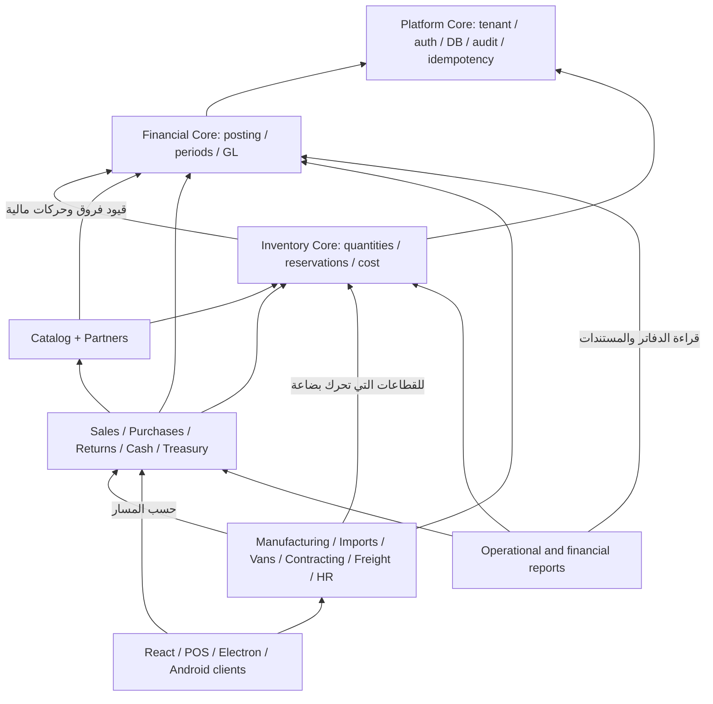
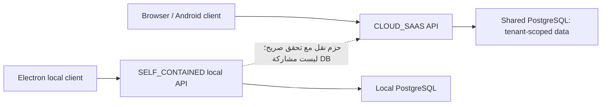
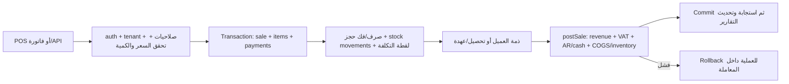
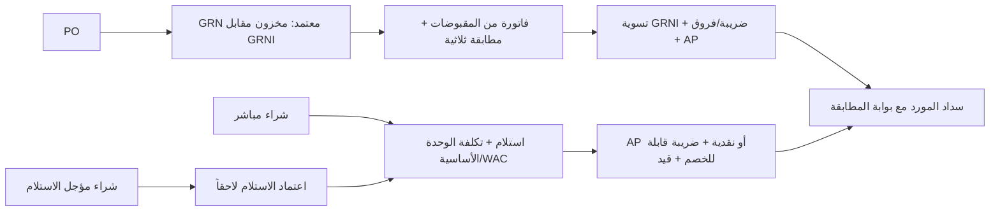
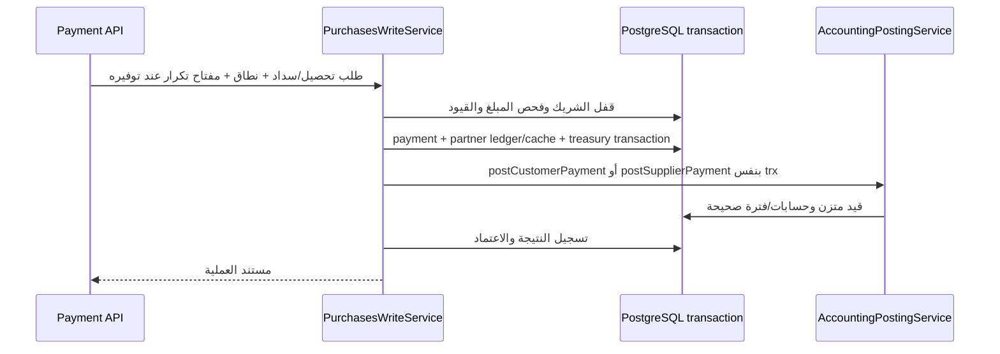
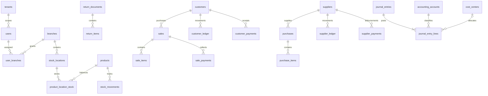

# Z-Systems — خريطة النظام المعمارية

تاريخ المراجعة: 25 أكتوبر 2026 (UTC). اللقطة المرجعية: `15876f6e6fea0e16609261836911c48d44b19f6e`.

هذه نقطة البداية لفهم النظام وتحديد نطاق مراجعة جديدة. تصف التنفيذ الموجود، وتفصل عنه قواعد التصميم المطلوبة والفجوات. التصنيف هنا تصنيف معماري مقترح للاستخدام في المراجعة؛ لا يغيّر أسماء الموديولات أو الصلاحيات أو الباقات.

**حدود الدليل:** جرى حصر موديولات الباك إند الـ37 وقراءة تسجيلها وتبعياتها، وفحص مداخل التشغيل والواجهة، وتتبع مسارات مالية ومخزنية مركزية، ومقارنة الهجرات والأنواع والاختبارات والوثائق. هذا مسح معماري للمستودع كله، وليس تدقيقاً سطراً بسطر لكل ملف أو اختباراً لكل قطاع. لا تُحوّل عبارة «موجود في الكود» إلى «مُعتمد في الإنتاج».

خريطة توثيق القدرات: [الفهرس المركزي](SYSTEM_CAPABILITIES.md) يوجّه إلى ملف كل مجال. اتبع [بروتوكول التحديث](docs/capabilities/README.md)؛ تفاصيل الميزات تُحدّث في ملف المجال، والتبعيات في هذه الخريطة.

## 1. ابدأ هنا في أي شات جديد

1. اقرأ [AGENTS.md](AGENTS.md) و[دستور عزل البيئات](SAAS_ELECTRON_ISOLATION_CONSTITUTION.md)، ثم هذه الخريطة.
2. حدّد الـcommit والفرع ووضع التشغيل والقطاع ونوع العملية المطلوب مراجعتها.
3. اقرأ القواعد ذات الصلة من [ARCHITECTURE_INVARIANTS.md](ARCHITECTURE_INVARIANTS.md). راجع تعارضات الوثائق في القسم 10 قبل تبني ادعاء قديم.
4. ابحث عن الموديول في القسم 4، ثم اتبع مسار العملية في القسم 6 ومصادر الحقيقة في القسم 5.
5. تتبّع: واجهة المستخدم ← API/DTO والحُرّاس ← الخدمة ← المعاملة والأقفال ← الجداول والدفاتر ← التقارير والاختبارات.
6. استخدم [REVIEW_ROADMAP.md](REVIEW_ROADMAP.md) كسجل مراجعات تاريخي، مع تقرير أحدث محدد النطاق والـcommit. لا تعتبر علامة «مغلق» شهادة لكل تغيير لاحق.
7. وثّق النتيجة: ما قرأته، ما اختبرته فعلاً، ما لم يُتحقق منه، وأثر أي تعديل على المستهلكين.

ترتيب الأدلة: الدستور يحدد السلوك المسموح؛ الكود يوضح السلوك المنفذ؛ الهجرات تحدد مخطط قاعدة جديدة؛ مخطط قاعدة منشورة وسجل هجراتها يحددان واقعها؛ الاختبار يثبت فقط السيناريو الذي نفذه. الاختلاف بين هذه الأدلة يُسجل، ولا يُحل بافتراض أن الوثيقة أو الكود صحيح تلقائياً.

## 2. القلب والفروع

النظام **تطبيق NestJS مركب من موديولات يشترك في قاعدة PostgreSQL**، مع واجهة React/Vite وبيئات تغليف متعددة. مجلد module لا يعني خدمة مستقلة أو قاعدة بيانات مستقلة. الدليل: [AppModule](backend/src/app.module.ts)، [DatabaseModule](backend/src/database/database.module.ts)، و[تركيب الواجهة](frontend/ARCHITECTURE.md).

- **Platform Core:** الهوية وعزل الشركات والجلسات والصلاحيات والإعدادات التشغيلية وقاعدة البيانات والتدقيق ومنع تكرار الطلبات. أي خلل فيه يمكن أن يتجاوز حدود موديول واحد.
- **Financial Core:** تهيئة الحسابات والترحيل المزدوج والفترات والعكس والأستاذ والتسويات. هو أساس الأثر المالي، وليس أباً لكل خدمة تقنية.
- **Inventory Core:** مواقع وكميات وحجوزات وحركات وتكلفة المخزون. بعضه في `common/utils` وبعضه في الموديولات؛ حدود المجلد ليست حدود هذا الكور.
- **Primary:** عمليات تسجل أموالاً أو مخزوناً أو التزامات، أو تتحكم في اعتمادها. منها البيع والشراء والمرتجع والقطاعات.
- **Secondary:** أدوات مساعدة وعرض وتكاملات. هذه أولوية تبعية عامة وليست تصريحاً بتجاهل الأمن؛ webhook دفع أو تسريب تقرير مالي يرفع المهمة إلى أولوية قصوى.

في الرسم التالي السهم يعني **«يعتمد على» من المستهلك إلى المكوّن الذي يستخدمه**. هذا رسم مسؤوليات وتجميع، وليس ترتيب تنفيذ أو رسماً لكل import.

المحاسبة تستعلم أيضاً عن مستندات البيع والشراء والمرتجع لتكوين القيد. لذلك الاعتماد على مستوى **البيانات** ليس شجرة أحادية الاتجاه، حتى حين يكون استيراد NestModule في اتجاه واحد.

## 3. حدود التشغيل وخريطة المستودع

| المسار | دوره ومصدر الدخول |
| --- | --- |
| `backend/src/main.ts`، `backend/src/app.module.ts` | إقلاع HTTP وتجميع الخدمات والحُرّاس/middleware |
| `backend/src/core/` | auth، audit، idempotency، health، logging، tenant، tenant-transfer، alerts، utils؛ ليست كل المجلدات NestModules مستقلة |
| `backend/src/common/` | معاملات، أدوات مخزون وقفل، middleware، queue وأدوات مشتركة؛ يجب تضمينه في مراجعة الكور |
| `backend/src/config/` و`backend/src/database/` | وضع التشغيل والتحقق من البيئة والاتصال والأنواع والهجرات |
| `backend/src/modules/` | الـ37 مجالاً في القسم التالي |
| `frontend/src/app/` | providers، registry، router، access، query invalidation |
| `frontend/src/features/` | صفحات وAPI/hooks لكل نشاط؛ لا توجد مطابقة واحد لواحد مع موديولات الباك إند |
| `frontend/src/shared/` و`frontend/src/lib/` | shell، النقل HTTP، مكونات مشتركة، أدوات عرض وتخزين |
| `frontend/electron/` و`portable/` | تشغيل وتغليف محلي؛ [PostgresManager](frontend/electron/postgres-manager.cjs) يدير PostgreSQL المحلي |
| `android-app/` و`android-app-lite/` | أغلفة Android وتكامل طباعة/دفع/ECR؛ افحص manifests وMainActivity عند مراجعة الاتصال المحلي |
| `tools/zs-eta-signer/` | أداة توقيع ضريبي مساندة؛ ليست مصدراً لحقيقة أرصدة النظام |
| `scripts/`، `deploy/`، `.github/workflows/` | بناء وتغليف وإصدار ونشر ونسخ احتياطي وحواجز CI |
| `backend/test/`، اختبارات الواجهة، `load-tests/` | أدلة تحقق مختلفة: وحدات وخدمات وقاعدة بيانات وواجهات وتحميل |
| `docs/` وملفات الجذر | وثائق قدرات ودساتير وتقارير بتاريخها؛ الأرشيف ليس وصفاً مضموناً للرأس الحالي |
| `releases/`، `logs/`، المخرجات المولدة | آثار تشغيل/إصدار؛ لا تُستخدم بديلاً عن المصدر أو دليلاً على نشر النسخة الحالية |

`index.js` و`server.js` يحيلان إلى [hostinger-api-entry.cjs](hostinger-api-entry.cjs)، الذي يشغّل `backend/dist/main.js`. الاسم القديم «hostinger» لا يثبت وجود باك إند مستقل.

افصل ثلاثة محاور: **وضع التشغيل** (`CLOUD_SAAS` / `SELF_CONTAINED` / `LOCAL_PILOT`)، **النشاط التجاري**، **الباقة والصلاحيات والميزات الظاهرة**. إخفاء شاشة المحاسبة في التشغيل المبسط لا يعني إيقاف الترحيل. مرجع الأوضاع المنفذ: [app-mode.ts](backend/src/config/app-mode.ts) و[env.schema.ts](backend/src/config/env.schema.ts). flags مثل `IS_ELECTRON` لا تمنح صلاحية Desktop فوق Cloud وفق التنفيذ الحالي. راجع [مصفوفة المودات والباقات](SYSTEM_MODES_AND_TIERS_MATRIX.md) للتصميم التجاري، ثم تحقق من حُرّاس الخادم والواجهة.

## 4. سجل جميع موديولات الباك إند

كل اسم أدناه مجلد تحت `backend/src/modules/` وله ملف `.module.ts`. الجداول أمثلة رئيسية من استخدام الكود، لا حصر كامل ولا ادعاء ملكية حصرية. «التبعيات» تشمل استهلاك خدمات أو بيانات؛ قائمة imports الدقيقة في القسم التالي.

| Module | الطبقة | المسؤولية والتبعيات المهمة | الجداول/البيانات الرئيسية |
| --- | --- | --- | --- |
| `accounting` | Core | الأستاذ، إعداد الحسابات، الأقفال، العكس، التقارير المالية؛ يقرأ مستندات المجالات | `accounting_accounts`, `accounting_settings`, `journal_entries`, `journal_entry_lines`, `accounting_cheques` |
| `inventory` | Core | أرصدة المواقع والحركات والتحويل والجرد؛ Accounting وأدوات المخزون المشتركة | `products`, `product_location_stock`, `stock_movements`, `stock_transfers` |
| `catalog` | Core | بيانات الصنف والوحدات والتسلسل؛ Inventory وAccounting عند الأثر المالي | `products`, `product_units`, `product_serials`, `product_categories` |
| `partners` | Core | هوية العميل/المورد وأرصدة الافتتاح؛ Accounting | `customers`, `suppliers`, `customer_ledger`, `supplier_ledger` |
| `users` | Core | المستخدمون وربط الفروع والصلاحيات | `users`, `user_branches`, `sessions` |
| `sessions` | Core | جلسات الدخول وMFA واستعادة كلمة المرور؛ Auth/Activation | `sessions`, `user_mfa`, `password_reset_tokens` |
| `settings` | Core | إعدادات مشتركة وفروع ونسخ/نقل وتحديثات؛ دور مختلط يتجاوز CRUD | `settings`, `branches`, `stock_locations`, `offline_releases` |
| `activation` | Core | تهيئة وتفعيل التشغيل المحلي وحدوده | `settings`, `users`, `tenants`, `branches` |
| `tenant-subscription` | Core | استحقاق الاشتراك والباقة وحدود المنشأة | `tenants`, `tenant_subscriptions`, `saas_plans` |
| `saas-admin` | Core | مستوى إدارة المنصة؛ لا يختلط بدفاتر متجر `zs` | `tenants`, `tenant_subscriptions`, `tenant_subscription_payments` |
| `sales` | Primary | فواتير/أوامر بيع وتسعير وتقسيط؛ Accounting وReturns وSettings والمخزون | `sales`, `sale_items`, `sale_payments`, `sales_orders`, `customer_installments` |
| `purchases` | Primary | شراء وPO وGRN ومطابقة وسداد **وتحصيل العملاء** | `purchases`, `purchase_items`, `purchase_orders`, `goods_receipt_notes`, `supplier_payments`, `customer_payments` |
| `returns` | Primary | مرتجعات بيع وشراء وتسوياتها؛ المستند الأصلي والتكلفة وAccounting | `return_documents`, `return_items`, دفاتر الشركاء وحركات المخزون |
| `cash-drawer` | Primary | ورديات وعهدة الصندوق وفروق الإقفال؛ Accounting وSettings | `cashier_shifts`, `users`, `branches` |
| `treasury` | Primary | حركات النقدية والبنك والأثر المحاسبي | `treasury_transactions`, `accounting_accounts` |
| `services` | Primary | عمليات الخدمة وتسويتها؛ `postService` وAuth/Audit؛ يستخدم SQL خام أيضاً | `services`, `treasury_transactions`, `cashier_shifts` |
| `pricing` | Primary | قواعد الأسعار وتغييراتها؛ Catalog/العملاء | `pricing_rules`, `price_change_runs`, `product_pricing_profiles` |
| `approvals` | Primary | موافقات تمنح/تحجب التنفيذ؛ Settings والمستند المعتمد | `approval_requests`, `approval_rules`, `approval_request_logs` |
| `manager-actions` | Primary | استثناءات المدير وإجراءات واسعة الأثر | `sales`, `sale_items`, `customer_ledger`, `settings` |
| `manufacturing` | Primary | BOM وأوامر تشغيل واستهلاك وإنتاج؛ Inventory وAccounting | `manufacturing_boms`, `manufacturing_bom_lines`, `manufacturing_work_orders` |
| `import-sales` | Primary | مشاريع وشحنات استيراد وتكلفة إنزالية وشركاء؛ مخزون وAP وAccounting | `import_projects`, `import_shipments`, `import_shipment_items`, `import_inventory_lots` |
| `delivery-reps` | Primary | مناديب وفان وتحميل وبيع وتحصيل وتسوية؛ Sales وAccounting | `delivery_representatives`, `van_sales_trips`, `van_load_requisitions`, `fleet_vehicles` |
| `maritime-freight` | Primary | شحن وحاويات وناقلون وفواتير ونزاعات؛ Accounting وSettings | `maritime_jobs`, `maritime_containers`, `shipping_lines`, `maritime_carrier_invoices` |
| `contracting` | Primary | مشروعات وBOQ ومستخلصات ومقاولو باطن؛ Accounting | `contracting_projects`, `contracting_boq_items`, `contracting_invoices`, `contracting_subcontracts` |
| `hr` | Primary | موظفون وحضور وعقود ورواتب وتسويات؛ Accounting وAuth | `hr_employees`, `hr_attendance_records`, `hr_employment_contracts`, `hr_payroll_run_items` |
| `storefront` | Primary | طلبات عامة وحجز ودفع وتحويل لفاتورة؛ Sales وAccounting وSettings | `online_orders`, `storefront_coupons`, `products`, إعدادات بوابات الدفع |
| `maintenance` | Primary | تذاكر وقطع غيار وخزينة؛ نقطة مراجعة لتكامل GL | `maintenance_tickets`, `maintenance_ticket_parts`, `stock_movements`, `treasury_transactions` |
| `tradein` | Primary | استبدال/شراء أجهزة أو بضائع مستعملة وأثرها | `trade_in_transactions`, `products`, `product_serials`, `treasury_transactions` |
| `pharmacy` | Primary | دفعات وصلاحية ووصفات وخدمات؛ مخزون ونقدية | `pharmacy_drugs`, `pharmacy_batches`, `pharmacy_prescriptions`, `pharmacy_clinical_services` |
| `tax-integration` | Primary | مستندات وإرسال ضريبي؛ Sales/Purchases/Accounting data والجهات الخارجية | `tenant_tax_settings`, `zatca_egs_units`, `zatca_transmission_logs`, `sales` |
| `reports` | Secondary | قراءة وتلخيص؛ حساس أمنياً، وليس دفتر كتابة بديل | مستندات البيع والشراء والمخزون والخزينة والشركاء |
| `crm` | Secondary | فرص وأنشطة متابعة؛ Partners | `crm_deals`, `crm_activities`, `customers` |
| `addons` | Secondary | إضافات/خيارات أصناف تؤثر في التسعير والاستهلاك عند البيع | `addons`, `pos_modifier_groups`, `pos_modifier_options`, `product_pos_modifiers` |
| `ai-copilot` | Secondary | محادثة ومصادر معرفة وسياق أعمال؛ لا يُفترض أنه سلطة دفترية | `ai_chat_sessions`, `ai_chat_messages`, `ai_knowledge_sources` |
| `bosta` | Secondary | تكامل شحن طلبات المتجر | `online_orders`, `settings` |
| `gcc-shipping` | Secondary | تكامل شحن إقليمي | `online_orders`, `settings` |
| `public` | Secondary | تسجيل وتجربة عامة تستهلك SaasAdmin؛ يتحول إلى P0 عند بحث اختراق حدود الشركات | `trial_signups`, `tenants`, `users`, `tenant_subscriptions` |

### تبعيات Nest الفعلية ذات الأثر الواسع

مأخوذة من ملفات `*.module.ts`، وليست مقترحاً لإعادة ترتيبها:

| المستهلك | Imports ذات صلة |
| --- | --- |
| Accounting | Database، AuthFoundation |
| Inventory | Audit، Accounting |
| Catalog | Audit، Inventory، Accounting |
| Partners | Audit، Accounting |
| Sales | Database، Audit، AuthFoundation، Accounting، Settings، Returns |
| Purchases | Database، Audit، AuthFoundation، Accounting، Settings، Approvals |
| Returns | Database، Audit، AuthFoundation، Accounting، Settings |
| Manufacturing | Database، Inventory، Accounting |
| DeliveryReps | Audit، Database، Accounting، Sales، Settings |
| Storefront | Accounting، Database، Audit، Sales، Settings |
| MaritimeFreight | Accounting، Settings |
| Contracting / ImportSales | Accounting |
| HR | Database، Audit، AuthFoundation، Accounting |
| Approvals → Settings → AiCopilot | سلسلة اعتماد فعلية يجب أخذها في اختبار تركيب التطبيق |
| Public → SaasAdmin → Settings | خدمات التسجيل العام تعبر إلى خدمات إدارية؛ الحُرّاس والتفويض جزء من المسار |

Auth/Audit/Idempotency/Logging توجد بينها موديولات `@Global()`؛ غياب import صريح من ملف موديول لا يعني عزله عن الكور. كذلك استيراد `location-stock-ledger` مباشرة لا يظهر كحافة NestModule.

## 5. مصدر الحقيقة لكل قاعدة أساسية

| القاعدة | مصدر التنفيذ الذي يجب قراءته | أثر التحقق |
| --- | --- | --- |
| وضع التشغيل وحدود Cloud/Desktop | [app-mode](backend/src/config/app-mode.ts)، [env schema](backend/src/config/env.schema.ts) | لا تستنتج الصلاحيات من اسم الملف أو flag منفرد |
| نطاق الشركة وحماية المنصة | [tenant-boundary](backend/src/core/auth/utils/tenant-boundary.ts)، حُرّاس `core/auth`، هجرة `2040000000229_fortify_platform_tenant_and_superadmin_immunity.ts` | نطاق كل query وjoin، وليس شاشة الدخول فقط |
| كلمة المرور والجلسة | [password-hasher](backend/src/core/auth/utils/password-hasher.ts)، [SessionService](backend/src/core/auth/services/session.service.ts) | bcrypt، جلسة صالحة، صلاحيات الخادم |
| تركيب البيانات | [migrations](backend/src/database/migrations)، [migration-runner](backend/src/database/migration-runner.ts)، [database.types](backend/src/database/database.types.ts) | الأنواع وصف برمجي، لا تثبت تطبيق الهجرة على قاعدة العميل |
| تنفيذ ذري ومنع التكرار | [TransactionHelper](backend/src/database/helpers/transaction.helper.ts)، [IdempotencyService](backend/src/core/idempotency/idempotency.service.ts) | المستند والدفاتر داخل المعاملة نفسها؛ إعادة الطلب لا تعني إعادة الحركة |
| دليل الحسابات وخريطة الإعدادات | [AccountingTenantFoundationService](backend/src/modules/accounting/accounting-tenant-foundation.service.ts)، `accounting/engines/accounting-foundation.engine.ts` | اكتمال الحسابات بالأكواد والخريطة، لا بعدد صفوف الشجرة |
| بناء القيد وترحيله | [AccountingPostingService](backend/src/modules/accounting/accounting-posting.service.ts): `postSale`, `postPurchase`, `postDomainJournal`, `insertPostedJournal` | اتزان، حسابات صحيحة، tenant، قفل وتكرار؛ توجد كتابات خاصة يجب فحصها أيضاً |
| القيود اليدوية والعكس | [AccountingService](backend/src/modules/accounting/accounting.service.ts): `createManualJournalEntry`, `reverseJournalEntry`, `validateBalancedLines`؛ [محرك العكس](backend/src/modules/accounting/engines/journal-reversal.engine.ts) | تحقق الأطراف والحسابات والمبالغ، منع العكس المكرر؛ القيد الآلي يُعكس من مستنده الأصلي للحفاظ على المخزون والدفاتر المساعدة |
| عملة الأساس وفروق الصرف | [accounting-currency](backend/src/modules/accounting/accounting-currency.ts)، [ForexRevaluationService](backend/src/modules/accounting/services/forex-revaluation.service.ts)، [pdc-currency](backend/src/modules/accounting/pdc-currency.ts) | تطابق إعداد العملة مع سعر الأساس، فصل القيمة الأجنبية عن الدفترية، الاحتفاظ بقيمة الحدث الأصلي عند العكس |
| تاريخ القيد والأقفال | [accounting-period-lock](backend/src/modules/accounting/accounting-period-lock.ts)، [accounting-tax-lock](backend/src/modules/accounting/accounting-tax-lock.ts)، [accounting-boundaries](backend/src/modules/accounting/accounting-boundaries.ts) | تاريخ العمل والضريبة والشهر؛ القفل داخل transaction |
| الإقفال وإعادة الفتح | [FiscalYearService](backend/src/modules/accounting/services/fiscal-year.service.ts)، [close readiness](backend/src/modules/accounting/accounting-close-readiness.ts) | مصادر بلا قيد، مسودات، فوائد، فروق؛ إعادة الفتح لا تلغي كل قفل إداري |
| كمية الموقع والحجز | [location-stock-ledger](backend/src/common/utils/location-stock-ledger.ts)، [canonical-lock-order](backend/src/common/utils/canonical-lock-order.ts) | المصدر التشغيلي `product_location_stock` مع تحديث إجمالي الصنف؛ لا تعدّل الإجمالي وحده |
| تكلفة المخزون وتكلفة المرتجع | [inventory-valuation](backend/src/modules/accounting/inventory-valuation.ts)، [محركات المحاسبة](backend/src/modules/accounting/engines)، `return_items.cost_price` ولقطات بنود البيع | WAC والوحدة الأساسية والتكلفة التاريخية؛ لا تستخدم سعر البيع لتقييم المخزون |
| AR/AP وهوية الشريك | [partner-subledger](backend/src/modules/accounting/partner-subledger.ts)، خدمات finance في البيع/الشراء والمرتجعات | `customers.balance`/`suppliers.balance` أرصدة مخزنة يجب مطابقتها؛ shipping_line ليس supplier تلقائياً |
| إعدادات وشاشات وباقات | [مصفوفة المودات](SYSTEM_MODES_AND_TIERS_MATRIX.md)، [سياسة التسعير](PRICING_AND_PACKAGING.md)، `tenant-subscription`، [router access](frontend/src/app/router/access.ts) | استحقاق الخادم والباقة مختلفان عن إخفاء القائمة |
| اتصال الواجهة وتحديث بياناتها | [HTTP](frontend/src/lib/http.ts)، [route registry](frontend/src/app/router/registry.ts)، [query invalidation](frontend/src/app/query-invalidation.ts) | توجيه الطلب والجلسة وتحديث الشاشة بعد العملية؛ cache الواجهة ليس بديلاً عن دفتر الخادم |
| النسخ والنقل | [SettingsBackupService](backend/src/modules/settings/services/settings-backup.service.ts)، [TenantTransferService](backend/src/modules/settings/services/tenant-transfer.service.ts)، `core/tenant-transfer` | حفظ IDs، النطاق، فحص اليتامى، حماية `zs` |
| تسوية الدفاتر | [accounting-integrity](backend/src/modules/accounting/accounting-integrity.ts)، [CLI](backend/scripts/check-accounting-integrity.ts) | تقرير قراءة فقط للـtenant، لا إعادة كتابة تلقائية للتاريخ |
| الأداء والنشر | [PERFORMANCE_CONSTITUTION.md](PERFORMANCE_CONSTITUTION.md)، [deploy workflow](.github/workflows/deploy-oracle.yml) | افحص تعليمات المسار قبل تغيير الاستيرادات أو الفهارس أو النشر |

لا يوجد «ملف واحد مصدر الحقيقة لكل شيء». توجد **ملكية قاعدة** وخدمة تنفيذ وجداول وقيود واختبار متصل بها. مثال: كمية المخزون لها مصدر تشغيلي، قيمته المحاسبية لها دفتر، والتسوية تثبت اتصالهما.

## 6. تدفقات الأعمال — السهم هنا ترتيب التنفيذ/الأثر

### 6.1 البيع

المصدر: [SalesWriteService](backend/src/modules/sales/services/sales-write.service.ts)، [SalesFinanceService](backend/src/modules/sales/services/sales-finance.service.ts)، ثم `AccountingPostingService.postSale`.

بيع البضاعة المعتاد ينتج أثراً للإيراد/الضريبة والتحصيل أو المديونية، وأثراً منفصلاً للتكلفة/المخزون. الخدمات والمدفوعات المختلطة ورصيد المتجر والفان والتصنيع عند البيع مسارات خاصة؛ لا تعمم قالب قيد واحد عليها. التعديل والإلغاء يحتاجان تتبع `reverseSaleJournal` وإعادة التسجيل، وليس زر تعديل القيد الآلي مباشرة.

### 6.2 الشراء والاستلام

المصدر: [PurchasesWriteService](backend/src/modules/purchases/services/purchases-write.service.ts)، [GoodsReceiptService](backend/src/modules/purchases/services/goods-receipt.service.ts)، [PurchaseLandedCostsService](backend/src/modules/purchases/services/purchase-landed-costs.service.ts).

هذه بدائل في دورة الشراء، وليست خطوات يجب تكرار المخزون خلالها. لا تضف مخزوناً مرة عند GRN ومرة عند فوترته. افحص `createBillFromReceipts` و`verifyPurchaseThreeWayMatch` وسقف المقبوض/المفوتر. عند الاستلام المؤجل تتحول تكلفة العبوة بعد الخصم إلى الوحدة الأساسية مع فصل الضريبة القابلة للاسترداد. التكلفة الإنزالية المتأخرة تحتاج فصل المباع والمتبقي.

### 6.3 المرتجع

المصدر: [ReturnsService](backend/src/modules/returns/returns.service.ts) و`postSalesReturn` / `postPurchaseReturn`.

المرتجع مستند تشغيلي، وليس عكساً يدوياً لقيد المصدر. راجع allocation الأصلي وموقع الصرف، وحدود التكرار، والضريبة، والرصيد المسترد. الاستبدال قد يربط مرتجعاً ببيع جديد ويجمع أثره في مسار خاص؛ لا تعتبر غياب قيد مستقل دليلاً وحده قبل فحص الربط.

### 6.4 التحصيل والسداد

المدخل الفعلي الأساسي في `PurchasesWriteService.createCustomerPayment` و`createSupplierPayment`، رغم اسم الموديول. خصص هذا المسار في أي مراجعة للخزينة أو الشركاء.

السداد يراعي الأقساط المحجوزة وبوابة المطابقة؛ التحصيل قد يتضمن مقدماً أو تخصيصاً لشحنة يملكها العميل. تخصيص الدفعة لفاتورة وظيفة مختلفة عن تسجيل أصل النقدية. الشيكات تمر بدورة مستقلة في [PdcChequesService](backend/src/modules/accounting/services/pdc-cheques.service.ts)، وتحتاج book amount وFX وحالة وتسلسل حدث؛ لا تُعامل كل انتقال كتحصيل جديد.

مسار القيود اليدوية منفصل: صلاحية المحاسبة → تحقق التاريخ والحسابات والأبعاد والمبالغ والاتزان → معاملة وقفل الفترة → القيد وبنوده ومزامنة دفتر الشريك عند اللزوم. العكس اليدوي ينشئ قيداً مقابلاً ويربطه بالأصل؛ الخدمة ترفض استخدام هذا المدخل لعكس قيد آلي، أو عكس قيد سبق عكسه أو سُوّيت بنوده بنكياً. مرجعه `AccountingService` في جدول مصادر الحقيقة.

### 6.5 نقطة اتصال القطاعات

| القطاع | مسار الاتصال الذي يبدأ منه التدقيق |
| --- | --- |
| Manufacturing | BOM → صرف مواد/تكلفة → إنتاج تام → `postManufacturingWorkOrder`؛ افحص الإكمال والإلغاء والتصنيع من البيع |
| Import | شحنة/بنود/عملة/تكلفة إنزالية → استلام lots ومخزون → AP وGL → توزيع التكاليف المتأخرة؛ افحص المشاريع والشركاء أيضاً |
| Vans | تحميل مخزن/عربية → بيع ميداني → تحصيل/مرتجع → تسوية رحلة وعهدة؛ الاعتماد على Sales لا يغطي وحده كل كتابة الفان |
| Contracting | مشروع/BOQ → مستخلص/حجز/سلفة أو مستخلص باطن → `postDomainJournal` → دفتر الشريك؛ افحص السقوف التراكمية |
| Maritime | job → تكلفة/فاتورة ناقل → supplier mapping → قيد؛ credit note يعكس العملة والأبعاد الأصلية ويحدث ربحية job |
| HR | موظف/عقد/حضور → حساب الأجر → اعتماد accrual → دفع/قرض/تسوية نهائية → GL؛ التشريع حسب البلد يحتاج دليلاً مستقلاً |
| Storefront | طلب وحجز → دليل دفع موثوق → تحويل عبر Sales → تسليم؛ marketplace settlement مسار مالي آخر داخل الموديول |
| Maintenance / Trade-in / Pharmacy | افحص كل كتابة مخزون/خزينة وكيف تصل إلى GL؛ لا تفترض التغطية بسبب ظهورها في كتالوج القدرات |

## 7. خريطة البيانات وERD مختصر

الـERD التالي **علاقات أعمال مختارة**؛ الخط لا يعني بالضرورة وجود FK فعلي لكل علاقة. العلاقات polymorphic مثل `source_type/source_id` و`partner_type/partner_id` تحتاج تحققاً في الخدمة، ولا يمثلها FK إلى جدول واحد. يجب تضمين `tenant_id` في العلاقة والتحقق، حتى إذا كان `id` فريداً عالمياً.

| عائلة بيانات | ما الذي تمثله | ما يجب تسويته معها |
| --- | --- | --- |
| `sales` / `purchases` / `return_documents` وبنودها | الحقيقة التجارية للمستند والكميات والأسعار | الحركات والدفاتر وقيد المصدر |
| `product_location_stock` و`products.stock_qty` | رصيد الموقع وإجمالي مخزن بالصنف | الحركات والحجوزات والتكلفة؛ لا تغيّر أحدهما منفرداً |
| `stock_movements` ولقطات تكلفة البنود | أثر الكمية والتكلفة والتتبع | الرصيد الفعلي وCOGS/Inventory GL |
| `customer_ledger` / `supplier_ledger` | دفتر مساعد لكل شريك | الرصيد المخزن وAR/AP المعلّمة بالشريك |
| `journal_entries` / `journal_entry_lines` | الأستاذ المالي، حالة الترحيل وروابط العكس | اتزان القيد ثم تطابق المصادر والدفاتر المساعدة |
| `treasury_transactions` / `cashier_shifts` | الحركة التشغيلية للنقدية والعهدة | النقدية/البنك بالأستاذ وتسوية الوردية |
| `accounting_fiscal_years` / `accounting_fiscal_periods` / إعدادات lock dates | حدود الترحيل الزمنية | مصدر القفل وسبب إعادة الفتح وترتيبها |
| `accounting_posting_failures` | استرداد تاريخي/عمليات ترحيل معلقة | لا يسمح باعتبار المستند مكتمل الأثر لمجرد وجوده |
| `accounting_supplier_links` | ربط هوية قطاعية بهوية مورد محاسبي | tenant + domain + domain_id؛ لا تساوِ shipping_line_id بـsupplier_id |
| `accounting_marketplace_settlements` | هوية كشف تسوية ثابتة مع قيده | التكرار ومحتوى الكشف والعملة |
| `accounting_installment_interest` | مواعيد ومبالغ استحقاق التمويل | القسط وخطة التقسيط والقيد والأقفال |

هجرات الارتكاز: [accounting foundation](backend/src/database/migrations/20260529000100_accounting_foundation.ts)، [location ledger](backend/src/database/migrations/1710000006000-location-stock-ledger.ts)، [فترات شهرية](backend/src/database/migrations/2040000000143_accounting_fiscal_periods.ts)، [حجز مواقع](backend/src/database/migrations/2040000000145_subwarehouse_stock_reservation.ts)، [ARCH02](backend/src/database/migrations/2040000000252_arch02_accounting_foundation.ts)، [tenant references](backend/src/database/migrations/2040000000253_core_tenant_reference_integrity.ts).

`NOT VALID` في الهجرات الأخيرة يفرض القيود على الكتابات الجديدة ولا يشهد بسلامة كل التاريخ. `account_id` قد يعني نطاق حساب في جدول، ويعني FK إلى حساب الأستاذ في `journal_entry_lines`؛ لا تبنِ سكربت إصلاح عاماً اعتماداً على اسم العمود.

## 8. ترتيب المراجعة حسب الضرر والاعتماد

| الأولوية | النطاق | شرط الانتقال |
| --- | --- | --- |
| P0-A | Tenant/Auth/Permissions/App modes/DB/Restore | إثبات حدود الشركة والمنصة، وعدم فتح صلاحيات محلية في Cloud |
| P0-B | معاملات، أقفال، idempotency، helpers المشتركة | فشل منتصف العملية والتزامن لا ينتجان آثاراً جزئية أو مكررة |
| P0-C | Financial Core والمخزون المشترك | قيد متزن ومصادر صحيحة، كميات/تكلفة متصلة، لا bypass للأقفال |
| P1-A | بيع/شراء/مرتجع/تحصيل/سداد | دورة كاملة من مدخل المستخدم إلى التقرير مع سيناريو عكسي |
| P1-B | القطاعات المالية والمخزنية | اختبار القطاع مع الكور؛ لا الاكتفاء باختبار معادلة محلية |
| P1-C | تقارير وإقفال وضريبة ونسخ/استعادة فعلية | تسوية بيانات وتواريخ وعملات وصلاحيات؛ قبول تشغيلي |
| P2 | CRM وتجميل الواجهات والمساعدات وتكاملات غير مالية | مراجعة نطاقها، وترقيتها إلى P0/P1 فور لمس مال/أمن/مخزون |

المخزون والمحاسبة يراجعان معاً في مسائل التكلفة؛ لا يلزم انتظار «إغلاق كل المحاسبة» قبل اكتشاف فرق مخزني. والميزة الثانوية ذات مدخل عام أو كتابة مالية لا تؤجل لمجرد تصنيف مجلدها.

## 9. خريطة التحقق وحالة الأدلة

| محور | الدليل القابل للتشغيل/المراجعة |
| --- | --- |
| الكور وpool واحد وعزل المراجع | [core-integrity-audit.spec.ts](backend/test/critical/core-integrity-audit.spec.ts) |
| دورة خدمات فعلية على PostgreSQL | [core-accounting.postgres.spec.ts](backend/test/acceptance/core-accounting.postgres.spec.ts) |
| ترحيل/مرتجعات/أقفال/تكلفة | [accounting-commercial-posting.spec.ts](backend/test/critical/accounting-commercial-posting.spec.ts)، [arch02 engines](backend/test/critical/arch02-accounting-engines.spec.ts) |
| foundation والدفاتر | [accounting-foundation.spec.ts](backend/test/critical/accounting-foundation.spec.ts)، [accounting-ledger-hardening.spec.ts](backend/test/critical/accounting-ledger-hardening.spec.ts) |
| كميات/حجز/نطاق مواقع | [location-stock-ledger.spec.ts](backend/test/infra/location-stock-ledger.spec.ts)، [subwarehouse reservation](backend/test/critical/subwarehouse-stock-reservation.spec.ts) |
| المخزون والتصنيع والاستيراد والقطاعات | `backend/test/e2e/` و`backend/test/e2e/simulations/` وملفات القطاع في `backend/test/critical/`؛ افحص script التسجيل ومتطلبات DB قبل التنفيذ |
| الواجهة والصلاحيات والتغليف | `frontend/src/**/*.spec.*`، [router access tests](frontend/src/app/router/access.spec.ts)، `frontend/scripts/`، `scripts/test-electron-update-lifecycle.cjs` |
| بوابات مستمرة | [CI](.github/workflows/ci.yml)، [PostgreSQL acceptance](.github/workflows/accounting-acceptance.yml)، scripts في [backend/package.json](backend/package.json) و[frontend/package.json](frontend/package.json) |

تقرير [قبول 24 أكتوبر](docs/audit_packs/2026-10-24-core-accounting-postgres-acceptance.md) يوثق نجاح 18 سيناريو خدمات و10 اختبارات كور و133 ملف باك إند و419 اختبار واجهة على اللقطة التي راجعها. **هذه نتائج سابقة موثقة، لم تُعد الاختبارات في جلسة كتابة الخريطة.** لا يثبت وجود ملف اختبار تسجيله في CI أو نجاحه، ولا يثبت نجاح تركيب Nest تشغيل cron أو HTTP أو Electron. بيانات الإنتاج والقبول القطاعي/التشريعي والتشغيل المعبأ لها حدود منفصلة في التقرير.

## 10. تعارضات وفجوات يجب أن يراها أي AI

| الرمز | النتيجة | الدليل والأثر |
| --- | --- | --- |
| MAP-01 | تعدد «نقاط الدخول الوحيدة» | `REVIEW_ROADMAP.md` وملفات الوكلاء والقدرات. استخدم هذه الخريطة للفهم، الدستور للقواعد، والتقرير المحدد للنتيجة؛ لا تستبدلها جميعاً بملف ميزات |
| MAP-02 | تعليمات فرع قديمة | `CODEX.md` يثبت `audit/work` ويمنع فروعاً أخرى، بينما اللقطة الحالية على فرع إصلاح مأذون به. تعليمات المستخدم الحالية تتقدم؛ لا تغيّر فرعاً لمجرد نص تاريخي |
| MAP-03 | ادعاء استمرار البيع رغم فشل القيد قديم | `CODEX.md` يصف تسجيل failure دون حجب الكاشير؛ `SalesWriteService` الحالي ينتظر `postSale(trx,...)`. افحص المسار الحالي، ولا تعِد catch يبتلع خطأ الترحيل اعتماداً على الوصف |
| MAP-04 | «100%» ليست حالة موحدة | `SYSTEM_CAPABILITIES.md` يخلط اكتمال ميزة ونتيجة اختبارات ونِسَب جاهزية؛ أعلى `ARCHITECTURE_INVARIANTS.md` يحتفظ بسجل قبل الاختبارات. تقرير قبول أحدث له نطاق محدود؛ يلزم سجل حالة مرتبط بالـcommit والدليل |
| MAP-05 | وصف وضع Desktop قديم/أوسع | الدستور يذكر `IS_ELECTRON` وSQLite/Local Postgres؛ التنفيذ الحالي يحسم الصلاحيات من app mode ويحتوي PostgresManager. لم تُثبت هذه المراجعة محرك SQLite تشغيلياً بديلاً؛ لا تبنِ عليه تصميم نقل |
| MAP-06 | ترقيم هجرات متعارض تاريخياً | توجد بادئتان `2040000000252` وأطوال بادئات مختلفة؛ قاعدة Highest+1 العددية لا تتوافق تلقائياً مع ترتيب Kysely الأبجدي. افحص القرص وسجل الهجرات؛ لا تعِد ترقيم تاريخ مطبق |
| MAP-07 | مركزية الترحيل ليست كاملة شكلياً | `GoodsReceiptService` يتضمن كتابة مباشرة إلى `journal_entries` مع حراسة الفترة، بينما قطاعات تستخدم `postDomainJournal`. لا يكفي تدقيق `insertPostedJournal` وحدها لتغطية جميع الكتابات |
| MAP-08 | اقتران تنظيمي غير متوقع | تحصيل العملاء في Purchases؛ Sales يستورد Returns؛ Settings يستورد AiCopilot؛ Public يستورد SaasAdmin. راجع الرسم الفعلي عند تحليل أثر تعديل، لا أسماء المجلدات فقط |
| MAP-09 | اكتمال تكامل بعض القطاعات لم يُثبت هنا | Maintenance/Trade-in/Pharmacy تكتب مخزوناً/خزينة ولا تستورد AccountingModule صراحة. هذه **إشارة تدقيق وليست إثبات غياب GL**؛ يلزم تتبع جميع الاستدعاءات والـSQL والأحداث واختبار دورة القطاع |
| MAP-10 | ERD شامل فعلي غير موجود ضمن الرسومات التي عُثر عليها | الرسومات السابقة في `docs/CLAUDE_BRAIN.md` و`ANTIGRAVITY_HANDOFF.md` تخص منهج تدقيق/دمج. ERD هذه الوثيقة مختصر؛ استخراج كامل من DB مهاجرة ومراجعة FKs/polymorphic links عمل منفصل |
| MAP-11 | الظهور التجاري ليس تقسيم نشر | مصفوفة المودات تعرض محركات تجارية، وAppModule يجمع الخدمات في تطبيق واحد. لا تفترض أن إخفاء شاشة يمنع استدعاء API أو يعزل خدمة فعلياً |
| MAP-12 | السجل الكامل للتغطية ما زال جزئياً | توجد اختبارات قطاعية خارج القائمة الحرجة؛ هذه الخريطة لا تمنحها حالة نجاح تلقائية. مطلوب لاحقاً مصفوفة كل business invariant ↔ caller ↔ schema ↔ test ↔ last verified commit |

لم يُصلح أي سلوك تشغيلي أو تعارض وثائقي تاريخي ضمن هذه الجولة؛ تسجل الخريطة موضعه ليُراجع ضمن مهمة محددة. لا تعتبر الإشارات أعلاه قائمة ثغرات مؤكدة دون إعادة إنتاج المسار.

## 11. حفظ الخريطة من التقادم

عند إضافة موديول أو تغيير ملكية جدول أو مدخل كتابة أو اعتماد بين خدمات: حدّث صف الموديول ورسم الاعتماد ومسار العملية ومصدر القاعدة واختبارها وتاريخ اللقطة. عند مجرد تعديل شكل واجهة، حدّث كتالوج القدرات إن لزم ولا تغيّر تصنيف الكور.

لا تنسخ جميع تفاصيل `SYSTEM_CAPABILITIES.md` إلى هذا الملف؛ أبقِ الخريطة مدخلاً وروابط أدلة. أي خريطة مولدة من imports وحدها تفوّت SQL الخام والموديولات العالمية ومساعدات `common` والتبعيات على مستوى البيانات. وأي ERD مولد من FKs وحدها يفوّت علاقات المصدر والشريك متعددة الأنواع.

نص بداية مناسب للمراجعات القادمة:

> اقرأ SYSTEM_BLUEPRINT.md والدستور وAGENTS.md. حدّد المسار المطلوب وتبعياته ومصادر قواعده والجداول المتأثرة والاختبارات المتصلة به. قارن ذلك بالكود الحالي والـcommit قبل اقتراح تغيير. اعرض ما ثبت وما بقي غير متحقق، ولا تعتبر حالة ميزة قديمة أو اختبار معادلة واحدة اعتماداً للدورة كاملة.
