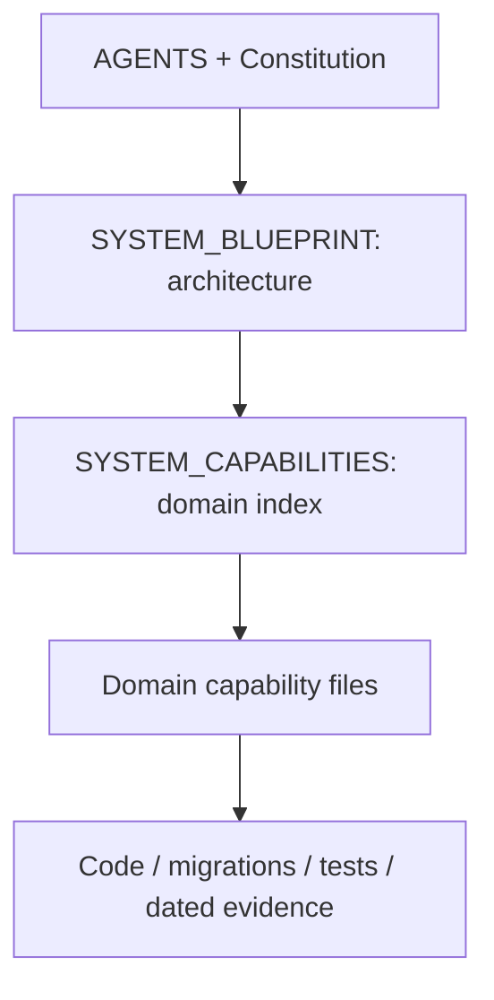

# دليل قدرات Z-Systems

هذا الملف **فهرس المجالات**؛ تفاصيل كل قدرة تُحدّث في ملف مجالها، ولا تُضاف هنا سجلات الميزات الطويلة.

ابدأ بـ[الخريطة المعمارية](SYSTEM_BLUEPRINT.md) لمعرفة القلب والتبعيات، ثم اختر الملف أدناه. اقرأ [قواعد التوثيق](docs/capabilities/README.md) قبل الإضافة أو التعديل.

## خريطة المعرفة

## ملفات المجالات

| المجال | ملف التفاصيل | الموديولات المسؤولة |
| --- | --- | --- |
| الهوية والأمان وعزل الشركات | [PLATFORM_CAPABILITIES.md](PLATFORM_CAPABILITIES.md) | `activation`, `sessions`, `users` |
| التشغيل والنشر والأداء والنسخ الاحتياطي | [RUNTIME_CAPABILITIES.md](RUNTIME_CAPABILITIES.md) | مجال مشترك/قطاعي |
| الواجهة والتنقل والتوطين | [UI_CAPABILITIES.md](UI_CAPABILITIES.md) | مجال مشترك/قطاعي |
| التحقق والتدقيق والسجلات المشتركة | [QA_CAPABILITIES.md](QA_CAPABILITIES.md) | مجال مشترك/قطاعي |
| الإعدادات والأنشطة والباقات | [SETTINGS_CAPABILITIES.md](SETTINGS_CAPABILITIES.md) | `settings` |
| المحاسبة والخزينة والقيود | [ACCOUNTING_CAPABILITIES.md](ACCOUNTING_CAPABILITIES.md) | `accounting`, `cash-drawer`, `treasury` |
| الضرائب والتكامل الضريبي | [TAX_CAPABILITIES.md](TAX_CAPABILITIES.md) | `tax-integration` |
| المخزون والمستودعات | [INVENTORY_CAPABILITIES.md](INVENTORY_CAPABILITIES.md) | `inventory` |
| الأصناف والوحدات والمتغيرات | [CATALOG_CAPABILITIES.md](CATALOG_CAPABILITIES.md) | `catalog` |
| المبيعات ونقاط البيع | [SALES_CAPABILITIES.md](SALES_CAPABILITIES.md) | `sales` |
| المشتريات والموردون | [PURCHASES_CAPABILITIES.md](PURCHASES_CAPABILITIES.md) | `purchases` |
| العملاء والتحصيل والولاء | [PARTNERS_CAPABILITIES.md](PARTNERS_CAPABILITIES.md) | `partners` |
| التوصيل وأجور المناديب | [DELIVERY_CAPABILITIES.md](DELIVERY_CAPABILITIES.md) | `delivery-reps` |
| التوزيع الميداني والفان | [VANS_CAPABILITIES.md](VANS_CAPABILITIES.md) | مجال مشترك/قطاعي |
| الموارد البشرية والرواتب | [HR_CAPABILITIES.md](HR_CAPABILITIES.md) | `hr` |
| الصيانة | [MAINTENANCE_CAPABILITIES.md](MAINTENANCE_CAPABILITIES.md) | `maintenance` |
| التصنيع والجودة | [MANUFACTURING_CAPABILITIES.md](MANUFACTURING_CAPABILITIES.md) | `manufacturing` |
| الاستبدال والمستعمل | [TRADEIN_CAPABILITIES.md](TRADEIN_CAPABILITIES.md) | `tradein` |
| الصيدليات | [PHARMACY_CAPABILITIES.md](PHARMACY_CAPABILITIES.md) | `pharmacy` |
| المساعد الذكي وقنوات المحادثة | [AI_CAPABILITIES.md](AI_CAPABILITIES.md) | `ai-copilot` |
| إدارة المنصة والاشتراكات | [SAAS_CAPABILITIES.md](SAAS_CAPABILITIES.md) | `public`, `saas-admin`, `tenant-subscription` |
| المتجر الإلكتروني والمدفوعات والمنصات | [STOREFRONT_CAPABILITIES.md](STOREFRONT_CAPABILITIES.md) | `storefront` |
| التسعير والعروض | [PRICING_CAPABILITIES.md](PRICING_CAPABILITIES.md) | `addons`, `pricing` |
| التقارير والتحليلات | [REPORTS_CAPABILITIES.md](REPORTS_CAPABILITIES.md) | `reports` |
| تكاملات شركات الشحن | [SHIPPING_CAPABILITIES.md](SHIPPING_CAPABILITIES.md) | `bosta`, `gcc-shipping` |
| المطاعم والأغذية | [RESTAURANT_CAPABILITIES.md](RESTAURANT_CAPABILITIES.md) | مجال مشترك/قطاعي |
| الاستيراد والتجارة الدولية | [IMPORT_CAPABILITIES.md](IMPORT_CAPABILITIES.md) | `import-sales` |
| التجزئة والأنشطة التجارية | [RETAIL_COMMERCE_CAPABILITIES.md](RETAIL_COMMERCE_CAPABILITIES.md) | مجال مشترك/قطاعي |
| المقاولات | [CONTRACTING_CAPABILITIES.md](CONTRACTING_CAPABILITIES.md) | `contracting` |
| الشحن واللوجستيات الدولية | [FREIGHT_CAPABILITIES.md](FREIGHT_CAPABILITIES.md) | `maritime-freight` |
| إدارة علاقات العملاء والفرص | [CRM_CAPABILITIES.md](CRM_CAPABILITIES.md) | `crm` |
| المرتجعات | [RETURNS_CAPABILITIES.md](RETURNS_CAPABILITIES.md) | `returns` |
| الخدمات | [SERVICES_CAPABILITIES.md](SERVICES_CAPABILITIES.md) | `services` |
| الموافقات واستثناءات المدير | [APPROVALS_CAPABILITIES.md](APPROVALS_CAPABILITIES.md) | `approvals`, `manager-actions` |

## طريقة الاستخدام وحالة الأدلة

- كل موديولات الباك إند الـ37 لها ملف مالك في الجدول؛ المجال قد يجمع أكثر من موديول مرتبط. الفان له ملف مستقل رغم اشتراك تنفيذه مع `delivery-reps`.
- المطاعم والاستيراد والتجزئة تحتفظ بملفاتها السابقة؛ لم تُنشأ نسخة منافسة لها.
- تصنيف Core / Primary / Secondary واتجاه الاعتماد في [SYSTEM_BLUEPRINT.md](SYSTEM_BLUEPRINT.md). أوضاع التشغيل والقطاعات والباقات في [SYSTEM_MODES_AND_TIERS_MATRIX.md](SYSTEM_MODES_AND_TIERS_MATRIX.md).
- الثوابت في [ARCHITECTURE_INVARIANTS.md](ARCHITECTURE_INVARIANTS.md)، وقواعد الأداء في [PERFORMANCE_CONSTITUTION.md](PERFORMANCE_CONSTITUTION.md)، وقرارات المراجعة بتاريخها في [REVIEW_ROADMAP.md](REVIEW_ROADMAP.md).
- عبارات «مكتمل 100%» داخل المواد القديمة محفوظة لأمانة النقل؛ لا تعتمدها دون دليل حديث محدد النطاق.
- نُقل كل محتوى الفهرس السابق دون إسقاط نصوص، مع حفظ التكرارات التاريخية والإشارة إليها. [سجل النقل](docs/capabilities/migration-manifest.json) يربط كل قسم بمكانه ومعرّفه وبصمته وقت النقل. تاريخ التنظيم: 25 أكتوبر 2026.
- التغيير المشترك له ملف مالك واحد، وتضاف روابط من بقية المجالات؛ لا تنسخ الوصف أو نتائج الاختبار بينها.
